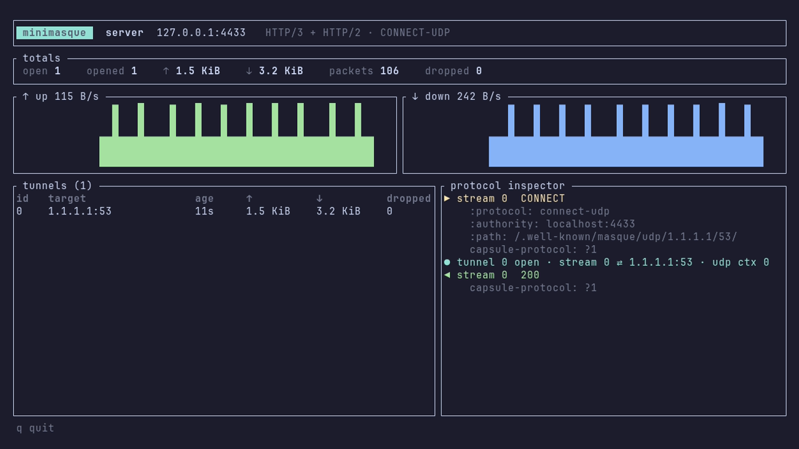
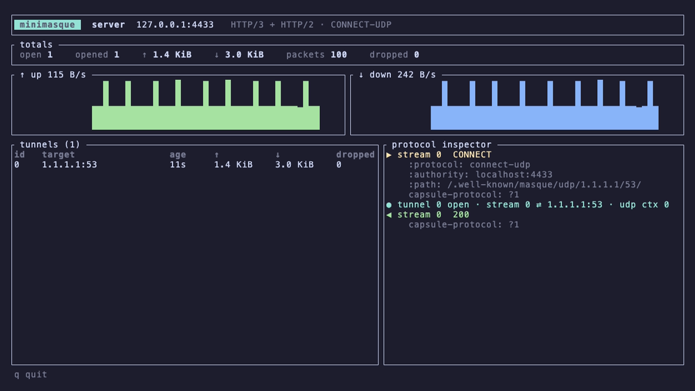
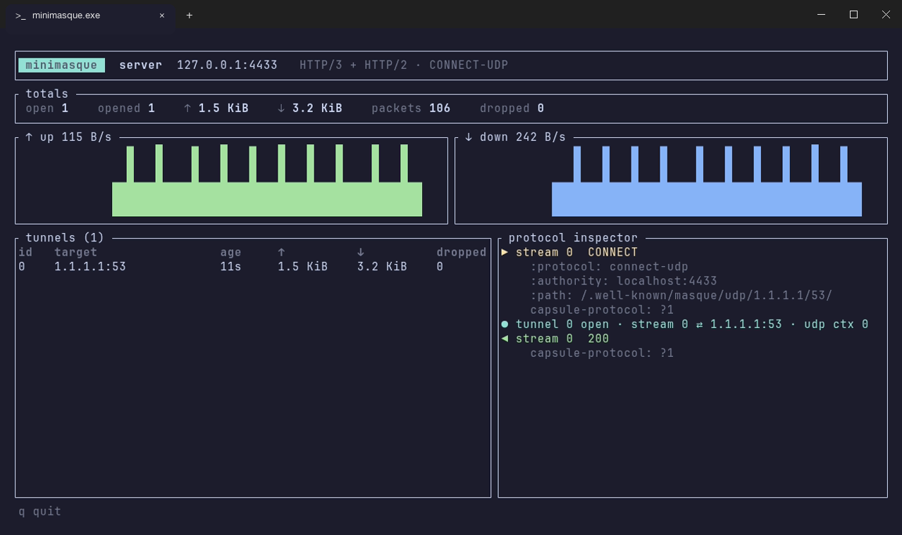
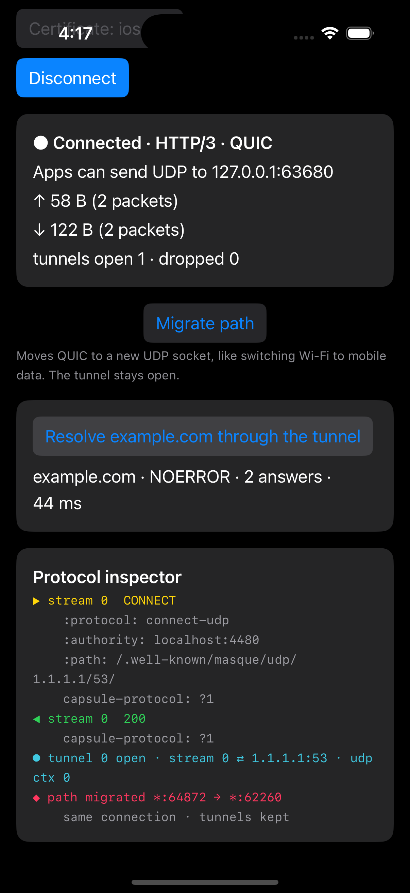
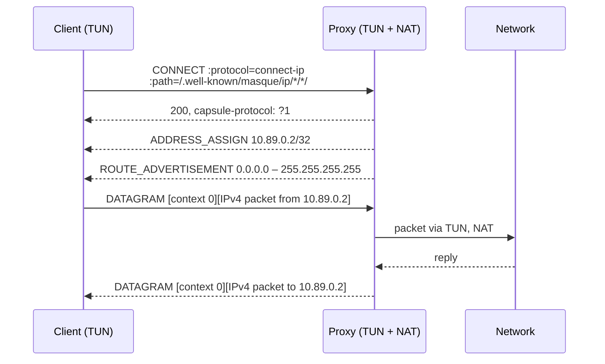
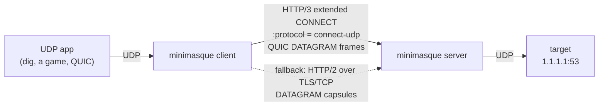
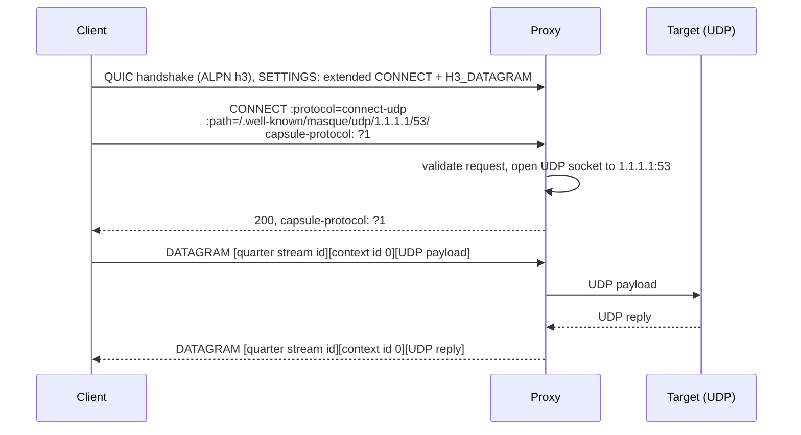
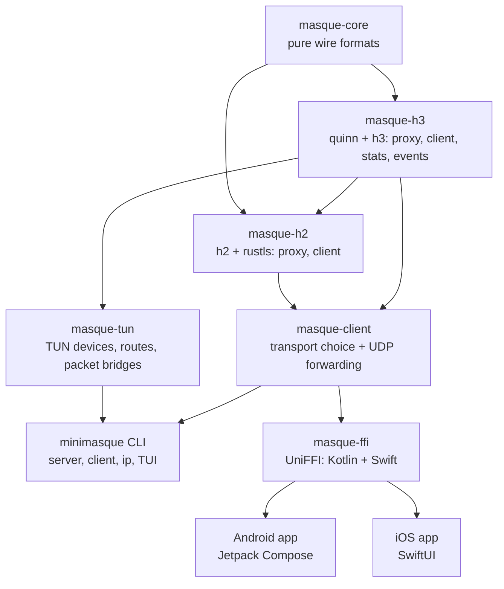

<h1 align="center">MiniMASQUE</h1>

<p align="center">
  A small, interop-tested MASQUE <b>CONNECT-UDP</b> and <b>CONNECT-IP</b> proxy and client in Rust.<br>
  HTTP/3 over QUIC first, HTTP/2 over TCP when UDP is blocked.
</p>

<p align="center">
  <a href="https://github.com/naimurhasan/minimasque/actions/workflows/ci.yml"></a>
  <a href="https://github.com/naimurhasan/minimasque/actions/workflows/interop.yml"></a>
  <a href="https://github.com/naimurhasan/minimasque/releases/latest"></a>
  
</p>

<p align="center">
  
</p>

## Why this exists

MASQUE tunnels UDP (RFC 9298) and whole IP packets (RFC 9484) inside HTTP. It is what iCloud Private Relay, Cloudflare WARP and other modern privacy proxies are built on. MiniMASQUE is a deliberately small implementation that makes the protocol visible and verifiable:

- **Sans-I/O core.** `masque-core` contains the wire formats (varints, capsules, URI templates, datagram framing, request checks) as pure functions with no networking and no HTTP library, so it can sit under any QUIC or HTTP stack.
- **Interop-tested.** An automated matrix runs every client against every proxy: MiniMASQUE, [masque-go](https://github.com/quic-go/masque-go) and [Google quiche](https://github.com/google/quiche). Apple's own MASQUE client in Network.framework also works with the MiniMASQUE proxy, over both HTTP/3 and HTTP/2.
- **HTTP/3 with an HTTP/2 fallback.** The same CONNECT-UDP tunnel runs over QUIC datagrams or, when UDP is blocked, over HTTP/2 DATAGRAM capsules. The client picks automatically.
- **A live protocol inspector.** `--tui` shows throughput, open tunnels and the actual extended CONNECT exchange as it happens.
- **CONNECT-IP, a real VPN path.** `minimasque ip` gets an address from the proxy, creates a TUN device and routes chosen prefixes through HTTP/3, so ping, DNS and TCP all work through the tunnel.
- **Visible connection migration.** Press `m` in the client TUI to move QUIC to a new UDP socket mid-session; the tunnel keeps flowing and both ends log the path change.
- **One core, many platforms.** The CLI runs on Linux, macOS and Windows; `masque-ffi` exposes the client to Kotlin and Swift through UniFFI.

## Quickstart

```sh
cargo build --release -p minimasque

# terminal 1: the proxy (HTTP/3 on UDP and HTTP/2 on TCP, same port)
./target/release/minimasque server --tui

# terminal 2: forward local UDP 5300 to 1.1.1.1:53 through the proxy
./target/release/minimasque client --proxy 127.0.0.1:4433 --target 1.1.1.1:53 --tui

# terminal 3: any UDP app now goes through the tunnel
dig @127.0.0.1 -p 5300 example.com
```

The server writes a self-signed certificate to `minimasque-cert.der`, and the client trusts it with `--ca`. To reach the proxy from another machine, add `--name <ip-or-hostname>` to the server and `--name` with the same value to the client.

| Client flag | Meaning |
|---|---|
| `--transport auto` | Try HTTP/3; after a 3 s QUIC timeout, fall back to HTTP/2 (default) |
| `--transport h3` / `h2` | Force one transport |
| `--template <uri>` | Use another proxy's URI template, e.g. `https://proxy:4433/masque?h={target_host}&p={target_port}` |

## Platforms

| Platform | Status | Evidence |
|---|---|---|
| Linux | CLI + TUI, proxy and client | [server dashboard](docs/assets/linux-server.png), recorded in Docker with VHS |
| macOS | CLI + TUI, proxy and client | [server dashboard](docs/assets/macos-server.png), recorded natively with VHS |
| Windows | CLI cross-compiles (`x86_64-pc-windows-gnu`) | builds a PE32+ console `minimasque.exe`; not yet run on Windows, so the [screenshot](docs/assets/windows-server.png) is a mock-up: the Linux dashboard in a Windows Terminal frame |
| Android | Jetpack Compose app on `masque-ffi` | [screenshot](docs/assets/android.png) from the Pixel 8 emulator |
| iOS | SwiftUI app on `masque-ffi` | [screenshot](docs/assets/ios.png) from the iPhone 16 Pro Simulator (iOS 18.6) |

<table>
  <tr>
    <td></td>
    <td></td>
    <td></td>
  </tr>
  <tr>
    <td align="center">Linux</td>
    <td align="center">macOS</td>
    <td align="center">Windows (mock-up)</td>
  </tr>
</table>

## Android


The Android app is a thin Jetpack Compose shell over the same Rust client (`masque-ffi`, loaded through UniFFI and JNA). It opens a tunnel, exposes a local UDP port for other code on the device, resolves a DNS name through the tunnel, migrates the QUIC path on demand, and shows the same protocol inspector as the TUI.

```sh
./apps/android/scripts/build-rust.sh      # cargo-ndk build + Kotlin bindings
cd apps/android && ./gradlew assembleDebug
```

On the emulator, run the proxy on the host with `--name 10.0.2.2`, push the certificate with `adb push minimasque-cert.der /sdcard/Download/`, and connect to `10.0.2.2:4433`. Requires the Android SDK and NDK, `cargo install cargo-ndk`, and `rustup target add aarch64-linux-android x86_64-linux-android`.

<br clear="right">

## iOS



The iOS app is the same idea in SwiftUI: `masque-ffi` is built as a static library for device and Simulator, wrapped in an XCFramework, and called through the UniFFI-generated Swift bindings.

```sh
./apps/ios/scripts/build-rust.sh          # Rust static libs, Swift bindings, XCFramework, Xcode project (XcodeGen)
open apps/ios/MiniMasque.xcodeproj
```

The Simulator shares the Mac's network, so it can reach a local proxy at `127.0.0.1`. For scripted runs, the app reads `MINIMASQUE_PROXY`, `MINIMASQUE_NAME`, `MINIMASQUE_CA_PATH`, `MINIMASQUE_AUTOCONNECT=1`, `MINIMASQUE_AUTOPROBE=1` and `MINIMASQUE_AUTOMIGRATE=1` (migrate, then probe again) from its environment (pass them as `SIMCTL_CHILD_*` to `xcrun simctl launch`). Requires Xcode, `brew install xcodegen`, and `rustup target add aarch64-apple-ios aarch64-apple-ios-sim`.

<br clear="right">

## Connection migration

When a phone moves from Wi-Fi to mobile data, its address changes. A TCP-based tunnel has to reconnect; a QUIC connection can migrate to the new path and keep its streams and datagrams. In the client TUI, `m` rebinds the client's QUIC endpoint to a fresh UDP socket, which looks to the proxy exactly like a network change:

<p align="center">
  
</p>

The tunnel, its stream and its counters survive, with nothing dropped. The proxy watches each connection's peer address and logs `◆ path migrated` in its own inspector when it changes. The Android and iOS apps have the same action as a **Migrate path** button (both screenshots above were taken after one). Migration is HTTP/3 only; the HTTP/2 fallback runs over TCP and cannot migrate.

## CONNECT-IP

CONNECT-UDP carries one UDP flow to one `host:port`. CONNECT-IP (RFC 9484) carries whole IP packets, so any protocol works and the operating system routes traffic into it like a VPN.

```sh
# proxy (Linux, root): serve CONNECT-IP from an address pool through a TUN device, NAT to the internet
sudo minimasque server --name proxy.example --ip-pool 10.89.0.0/24
sudo iptables -t nat -A POSTROUTING -s 10.89.0.0/24 -o eth0 -j MASQUERADE

# client (Linux or macOS, root): get an address, route chosen prefixes through the tunnel
sudo minimasque ip --proxy 203.0.113.7:4433 --name proxy.example --ca minimasque-cert.der --route 1.1.1.1/32
ping 1.1.1.1 && curl https://1.1.1.1/cdn-cgi/trace
```



| Tested | Result |
|---|---|
| Linux client → Linux proxy ([`demo/connect-ip/run.sh`](demo/connect-ip/run.sh), Docker) | ping, DNS and HTTPS to `1.1.1.1` ✅ |
| macOS client (`utun`) → Linux proxy in Docker Desktop | ping and HTTP to a private container network ✅ |

- The proxy assigns one address per session, drops packets whose source is not that address, and answers ADDRESS_REQUEST.
- Only the `--route` prefixes go through the tunnel, so the client's own QUIC connection to the proxy never loops back into it. On a Mac running the proxy in Docker Desktop, route private container subnets rather than internet addresses: Docker Desktop sends container traffic out through the Mac's own routing table, which would feed it back into the tunnel.
- Veth and Docker networking can hand the proxy packets with offloaded (unfinished) TCP/UDP checksums; the proxy recomputes them before forwarding to the client.
- CONNECT-IP is HTTP/3 only, IPv4 only for TUN addresses, and not yet in the mobile apps (Android `VpnService`, an iOS Network Extension). The `h3` crate's released version lacks `:protocol: connect-ip`, so h3 and h3-quinn are pinned to a git commit until the next release.

## How it works





Over HTTP/2 the request is the same extended CONNECT (RFC 8441), and each UDP payload travels on the request stream as a DATAGRAM capsule: `type 0x00 · length · context id 0 · payload`.

### Crates



| Crate | Contents |
|---|---|
| [`masque-core`](crates/masque-core) | QUIC varints, capsules, CONNECT-UDP and CONNECT-IP URI templates, address and route capsules, IP header and checksum helpers, context-ID datagrams, HTTP/3 datagram framing |
| [`masque-h3`](crates/masque-h3) | HTTP/3 proxy and client on quinn and h3 (CONNECT-UDP and CONNECT-IP with an address-pool gateway), per-tunnel stats, protocol events |
| [`masque-h2`](crates/masque-h2) | HTTP/2 extended CONNECT proxy and client with a streaming capsule reader |
| [`masque-client`](crates/masque-client) | `auto` / `h3` / `h2` transport selection and local UDP forwarding |
| [`masque-tun`](crates/masque-tun) | TUN devices (tun-rs), route setup on Linux and macOS, proxy and client packet bridges |
| [`masque-ffi`](crates/masque-ffi) | `Forwarder` object for Android and iOS through UniFFI |
| [`minimasque`](apps/cli) | The CLI and the ratatui dashboard |

## Interoperability

`./interop/run.sh` builds each implementation in Docker and runs every client against every proxy on a private network. MiniMASQUE clients forward a DNS query; masque-go and quiche clients fetch `https://cloudflare.com/cdn-cgi/trace` over HTTP/3 *inside* the tunnel (QUIC in QUIC).

| Client ↓ / Proxy → | minimasque | masque-go v0.6.0 | quiche @854314d |
|---|---|---|---|
| **minimasque** | ✅ | ✅ | ✅ |
| **masque-go** | ✅ | ✅ | ✅ |
| **quiche** | ✅ | ❌ | ✅ |

Last run: 2026-11-07. The one failing pair does not involve MiniMASQUE: the quiche client opens the tunnel through the masque-go proxy, but its inner QUIC handshake times out. The [Interop workflow](.github/workflows/interop.yml) runs the matrix on every push to `main` and weekly.

### Apple's built-in MASQUE client

macOS and iOS ship a MASQUE client in Network.framework (the stack behind iCloud Private Relay), exposed through `ProxyConfiguration.RelayHop`. [`interop/apple/run.sh`](interop/apple/run.sh) points it at a MiniMASQUE proxy and sends a DNS query to `1.1.1.1:53` from a plain UDP `NWConnection`. It passes only if the reply arrives *and* the proxy log shows the CONNECT-UDP request, so a silent direct fallback cannot count as a pass.

| Apple client (macOS 15.3) → MiniMASQUE proxy | Result |
|---|---|
| HTTP/3 relay | ✅ NOERROR |
| HTTP/2 relay | ✅ NOERROR |

Apple's request also carries `proxy-quic-forwarding: ?1` (QUIC-aware proxying, an IETF draft). MiniMASQUE does not echo it back, so the client uses plain CONNECT-UDP tunnelling.

## Standards coverage

| Spec | What is implemented |
|---|---|
| RFC 9000 §16 | Variable-length integers |
| RFC 9297 | Capsule protocol, DATAGRAM capsule, HTTP/3 datagram quarter stream ID, `capsule-protocol: ?1` |
| RFC 9298 | CONNECT-UDP request validation, URI template expansion and matching (path and query forms), context ID 0 |
| RFC 9220 | Extended CONNECT over HTTP/3 |
| RFC 8441 | Extended CONNECT over HTTP/2 (fallback transport) |
| RFC 9484 | CONNECT-IP over HTTP/3: `{target}`/`{ipproto}` templates with `*` wildcards, ADDRESS_ASSIGN, ADDRESS_REQUEST, ROUTE_ADVERTISEMENT (ordering checked), full IP packets in context ID 0 |

Not implemented yet: `{?target_host,target_port}` form-style template expressions, Proxy-Status responses, context ID registration for extensions, CONNECT-IP over HTTP/2, IPv6 TUN addresses, and CONNECT-IP scope enforcement (the proxy accepts `target`/`ipproto` but always advertises a full IPv4 route).

## Testing

```sh
cargo test --workspace            # unit, end-to-end, TUI render and FFI tests
./interop/run.sh                  # cross-implementation matrix (Docker)
./interop/apple/run.sh            # Apple Network.framework relay (macOS)
./demo/connect-ip/run.sh          # CONNECT-IP: ping, DNS and HTTPS through a TUN tunnel (Docker)
./docs/record-demo.sh             # re-record the GIF and Linux screenshot with VHS (Docker)
./docs/record-macos.sh            # re-record the macOS screenshot with VHS (brew install vhs)
vhs docs/migration.tape           # re-record the migration GIF (minimasque on PATH)
```

- End-to-end tests run real QUIC and TLS on loopback: UDP relay both ways, multiplexed tunnels, refused requests, protocol events, connection migration, CONNECT-IP address assignment and packet relay with spoof checks, HTTP/2 capsule relay, and automatic HTTP/2 fallback when QUIC is unreachable.
- The dashboard is rendered into ratatui's `TestBackend` and checked as text.
- CI runs `rustfmt`, `clippy -D warnings` and the tests on Linux, macOS and Windows.

## Roadmap

- [x] CONNECT-UDP over HTTP/3, proxy and client
- [x] Interop matrix against masque-go and Google quiche
- [x] Live TUI with protocol inspector
- [x] HTTP/2 fallback
- [x] Kotlin and Swift bindings
- [x] Android app (Jetpack Compose on `masque-ffi`)
- [x] Interop with Apple's built-in MASQUE client (Network.framework relays)
- [x] iOS app (SwiftUI on `masque-ffi`)
- [x] Connection migration demo (rebind mid-session without dropping the tunnel)
- [x] CONNECT-IP over HTTP/3 with TUN on Linux and macOS
- [ ] CONNECT-IP in the mobile apps (Android `VpnService`, iOS Network Extension)

## License

Dual-licensed under [MIT](LICENSE-MIT) or [Apache-2.0](LICENSE-APACHE), at your option.
