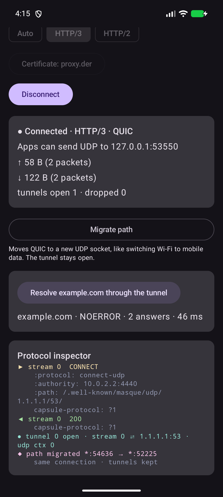
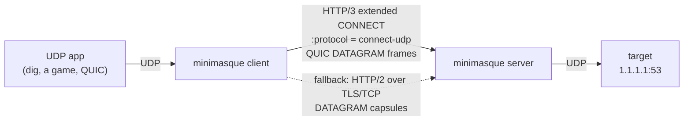
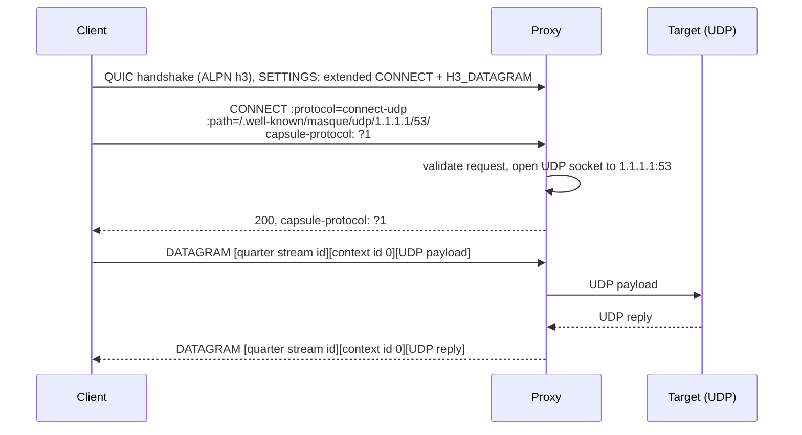
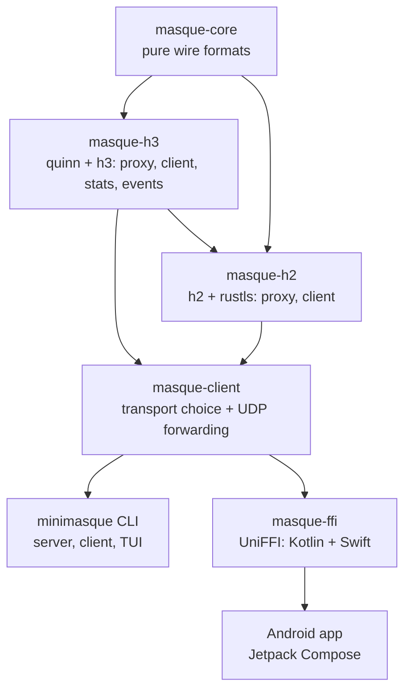

<h1 align="center">MiniMASQUE</h1>

<p align="center">
  A small, interop-tested MASQUE <b>CONNECT-UDP</b> proxy and client in Rust.<br>
  HTTP/3 over QUIC first, HTTP/2 over TCP when UDP is blocked.
</p>

<p align="center">
  
</p>

## Why this exists

MASQUE (RFC 9298) tunnels UDP inside HTTP. It is what iCloud Private Relay, Cloudflare WARP and other modern privacy proxies are built on. MiniMASQUE is a deliberately small implementation that makes the protocol visible and verifiable:

- **Sans-I/O core.** `masque-core` contains the wire formats (varints, capsules, URI templates, datagram framing, request checks) as pure functions with no networking and no HTTP library, so it can sit under any QUIC or HTTP stack.
- **Interop-tested.** An automated matrix runs every client against every proxy: MiniMASQUE, [masque-go](https://github.com/quic-go/masque-go) and [Google quiche](https://github.com/google/quiche). Apple's own MASQUE client in Network.framework also works with the MiniMASQUE proxy, over both HTTP/3 and HTTP/2.
- **HTTP/3 with an HTTP/2 fallback.** The same CONNECT-UDP tunnel runs over QUIC datagrams or, when UDP is blocked, over HTTP/2 DATAGRAM capsules. The client picks automatically.
- **A live protocol inspector.** `--tui` shows throughput, open tunnels and the actual extended CONNECT exchange as it happens.
- **One core, many platforms.** The CLI runs on Linux, macOS and Windows; `masque-ffi` exposes the client to Kotlin and Swift through UniFFI.

## Quickstart

```sh
cargo build --release -p minimasque

# terminal 1: the proxy (HTTP/3 on UDP and HTTP/2 on TCP, same port)
./target/release/minimasque server --tui

# terminal 2: forward local UDP 5300 to 1.1.1.1:53 through the proxy
./target/release/minimasque client --proxy 127.0.0.1:4433 --target 1.1.1.1:53 --tui

# terminal 3: any UDP app now goes through the tunnel
dig @127.0.0.1 -p 5300 example.com
```

The server writes a self-signed certificate to `minimasque-cert.der`, and the client trusts it with `--ca`. To reach the proxy from another machine, add `--name <ip-or-hostname>` to the server and `--name` with the same value to the client.

| Client flag | Meaning |
|---|---|
| `--transport auto` | Try HTTP/3; after a 3 s QUIC timeout, fall back to HTTP/2 (default) |
| `--transport h3` / `h2` | Force one transport |
| `--template <uri>` | Use another proxy's URI template, e.g. `https://proxy:4433/masque?h={target_host}&p={target_port}` |

## Android



The Android app is a thin Jetpack Compose shell over the same Rust client (`masque-ffi`, loaded through UniFFI and JNA). It opens a tunnel, exposes a local UDP port for other code on the device, resolves a DNS name through the tunnel, and shows the same protocol inspector as the TUI.

```sh
./apps/android/scripts/build-rust.sh      # cargo-ndk build + Kotlin bindings
cd apps/android && ./gradlew assembleDebug
```

On the emulator, run the proxy on the host with `--name 10.0.2.2`, push the certificate with `adb push minimasque-cert.der /sdcard/Download/`, and connect to `10.0.2.2:4433`. Requires the Android SDK and NDK, `cargo install cargo-ndk`, and `rustup target add aarch64-linux-android x86_64-linux-android`.

<br clear="right">

## How it works





Over HTTP/2 the request is the same extended CONNECT (RFC 8441), and each UDP payload travels on the request stream as a DATAGRAM capsule: `type 0x00 · length · context id 0 · payload`.

### Crates



| Crate | Contents |
|---|---|
| [`masque-core`](crates/masque-core) | QUIC varints, capsules, CONNECT-UDP URI templates and targets, context-ID datagrams, HTTP/3 datagram framing |
| [`masque-h3`](crates/masque-h3) | HTTP/3 proxy and client on quinn and h3, per-tunnel stats, protocol events |
| [`masque-h2`](crates/masque-h2) | HTTP/2 extended CONNECT proxy and client with a streaming capsule reader |
| [`masque-client`](crates/masque-client) | `auto` / `h3` / `h2` transport selection and local UDP forwarding |
| [`masque-ffi`](crates/masque-ffi) | `Forwarder` object for Android and iOS through UniFFI |
| [`minimasque`](apps/cli) | The CLI and the ratatui dashboard |

## Interoperability

`./interop/run.sh` builds each implementation in Docker and runs every client against every proxy on a private network. MiniMASQUE clients forward a DNS query; masque-go and quiche clients fetch `https://cloudflare.com/cdn-cgi/trace` over HTTP/3 *inside* the tunnel (QUIC in QUIC).

| Client ↓ / Proxy → | minimasque | masque-go v0.6.0 | quiche @854314d |
|---|---|---|---|
| **minimasque** | ✅ | ✅ | ✅ |
| **masque-go** | ✅ | ✅ | ✅ |
| **quiche** | ✅ | ❌ | ✅ |

Last run: 2026-11-07. The one failing pair does not involve MiniMASQUE: the quiche client opens the tunnel through the masque-go proxy, but its inner QUIC handshake times out. The [Interop workflow](.github/workflows/interop.yml) runs the matrix on every push to `main` and weekly.

### Apple's built-in MASQUE client

macOS and iOS ship a MASQUE client in Network.framework (the stack behind iCloud Private Relay), exposed through `ProxyConfiguration.RelayHop`. [`interop/apple/run.sh`](interop/apple/run.sh) points it at a MiniMASQUE proxy and sends a DNS query to `1.1.1.1:53` from a plain UDP `NWConnection`. It passes only if the reply arrives *and* the proxy log shows the CONNECT-UDP request, so a silent direct fallback cannot count as a pass.

| Apple client (macOS 15.3) → MiniMASQUE proxy | Result |
|---|---|
| HTTP/3 relay | ✅ NOERROR |
| HTTP/2 relay | ✅ NOERROR |

Apple's request also carries `proxy-quic-forwarding: ?1` (QUIC-aware proxying, an IETF draft). MiniMASQUE does not echo it back, so the client uses plain CONNECT-UDP tunnelling.

## Standards coverage

| Spec | What is implemented |
|---|---|
| RFC 9000 §16 | Variable-length integers |
| RFC 9297 | Capsule protocol, DATAGRAM capsule, HTTP/3 datagram quarter stream ID, `capsule-protocol: ?1` |
| RFC 9298 | CONNECT-UDP request validation, URI template expansion and matching (path and query forms), context ID 0 |
| RFC 9220 | Extended CONNECT over HTTP/3 |
| RFC 8441 | Extended CONNECT over HTTP/2 (fallback transport) |

Not implemented yet: `{?target_host,target_port}` form-style template expressions, Proxy-Status responses, context ID registration for extensions, and CONNECT-IP (RFC 9484).

## Testing

```sh
cargo test --workspace            # unit, end-to-end, TUI render and FFI tests
./interop/run.sh                  # cross-implementation matrix (Docker)
./interop/apple/run.sh            # Apple Network.framework relay (macOS)
./docs/record-demo.sh             # re-record docs/assets/demo.gif with VHS (Docker)
```

- End-to-end tests run real QUIC and TLS on loopback: UDP relay both ways, multiplexed tunnels, refused requests, protocol events, HTTP/2 capsule relay, and automatic HTTP/2 fallback when QUIC is unreachable.
- The dashboard is rendered into ratatui's `TestBackend` and checked as text.
- CI runs `rustfmt`, `clippy -D warnings` and the tests on Linux, macOS and Windows.

## Roadmap

- [x] CONNECT-UDP over HTTP/3, proxy and client
- [x] Interop matrix against masque-go and Google quiche
- [x] Live TUI with protocol inspector
- [x] HTTP/2 fallback
- [x] Kotlin and Swift bindings
- [x] Android app (Jetpack Compose on `masque-ffi`)
- [x] Interop with Apple's built-in MASQUE client (Network.framework relays)
- [ ] iOS app (SwiftUI on `masque-ffi`)
- [ ] Connection migration demo (Wi-Fi → mobile data without dropping the tunnel)
- [ ] CONNECT-IP

## License

Dual-licensed under [MIT](LICENSE-MIT) or [Apache-2.0](LICENSE-APACHE), at your option.
